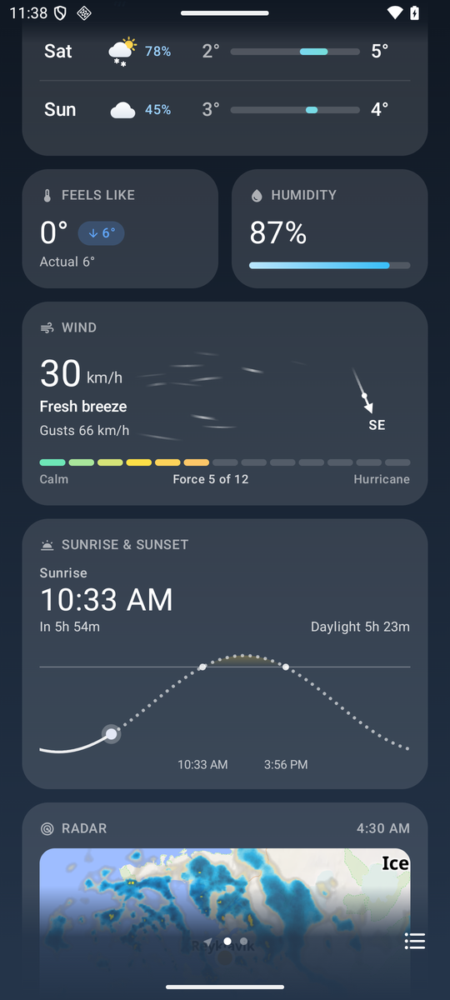
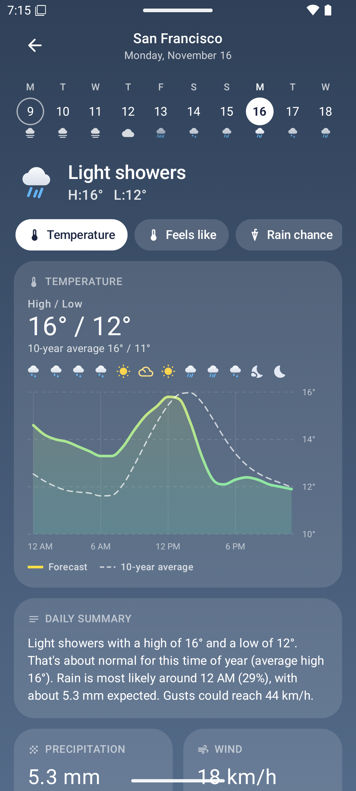
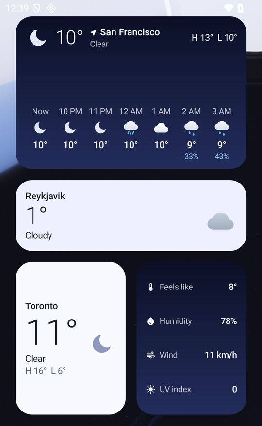
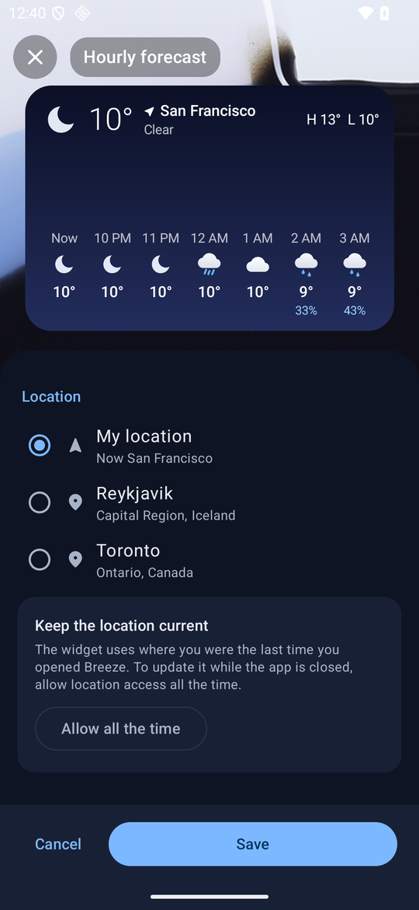

# Breeze

A clean, modern Android weather app built with Kotlin and Jetpack Compose.

<p>
  
  
  
  
</p>

## Features

- **Precise current location.** Asks for fine location and requests a fresh high-accuracy
  fix (it doesn't rely on a stale cached one). If you grant only *approximate* access, a
  small "Use precise" pill lets you upgrade later. If you've permanently denied access, the
  same button opens the app's system settings.
- **Saved locations.** Search any city worldwide and save it. Swipe between places on the
  home screen, or open the list to jump to one. Swipe a saved place left to remove it
  (with undo).
- **Uncluttered UI.** One big temperature, a compact 24-hour strip (six hours visible at a
  time), a 10-day forecast with temperature-range bars, and a few focused cards. The background
  gradient follows the current conditions and day/night.
  - **Day icons** show the weather while the sun is up: the most severe condition from the hour
    of sunrise to the hour after sunset (sunrise 7:45 and sunset 5:03 give 7 AM to 6 PM), so
    rain overnight doesn't make a dry day look rainy.
  - **Chance of rain** is shown whenever it's above 0%, in the app and in widgets.
  - **Feels like:** shows the difference from the actual temperature, colour-coded from blue
    (feels colder) to red (feels warmer).
  - **Wind:** animated streaks whose number, length and speed scale with the wind and point the
    way it blows. Also a compass and the Beaufort scale (force 0–12) with gusts.
  - **Sunrise & sunset:** the sun's path across the day. The curve is solid for time already
    passed and dotted for what's ahead, with the sun at its current position.
- **Day detail.** Tap any day in the 10-day forecast, or the 24-hour strip, for a full-day
  view, then switch days with the picker at the top. A 24-hour chart can show **temperature,
  feels like, rain chance, precipitation, humidity, wind (with gusts), UV index or cloud cover**.
  Tap or drag across it to read any hour. A dashed line shows the **10-year historical average**
  for that date and hour (from the ERA5 archive), and a plain-language daily summary compares
  the forecast with it.
- **Home screen widgets.** Six widgets in a range of sizes, all fully customizable (see below).
- **°C / °F toggle.** The default follows your locale.
- **Fast start and offline-friendly.** The last forecast for each place is cached on disk and
  shown instantly, then refreshed in the background. Pull down to refresh.
- **No API key needed.** Forecasts, geocoding and historical data come from [Open-Meteo](https://open-meteo.com/).
- **No Google Play Services dependency.** Location uses the platform `LocationManager`
  (with the fused provider on Android 12+).

## Widgets

<p>
  
  
</p>

| Widget | Default size | Shows |
| --- | --- | --- |
| **Now** | 2 × 1 | Icon and temperature (1 × 1 and up) |
| **Current conditions** | 2 × 2 | Place, large temperature, condition, high/low; readings beside it when wide |
| **Hourly forecast** | 4 × 2 | Current conditions and the next hours, with chance of rain |
| **Daily forecast** | 4 × 3 | Current conditions and up to 10 days with temperature bars |
| **Weather details** | 2 × 2 | Your pick of feels like, humidity, wind, UV, chance of rain, precipitation, sunrise, sunset, cloud cover, high/low |
| **Complete forecast** | 4 × 4 | Current conditions, hourly and daily together |
| **Hourly strip** | 4 × 1 | Icon, temperature, today's high over low, then the next hours (5 by default) |
| **Daily strip** | 4 × 1 | Icon, temperature, today's high over low, then the next days |
| **Mini** | 1 × 1 | Icon, temperature and today's high and low; side by side at 2 × 1 |

- **Every widget is resizable** and lays itself out for the size it's given: more hours, days or
  readings as it grows, and sections that don't fit are left out. A 4 × 1 hourly widget becomes
  just the hourly strip; a narrow details widget becomes a list.
- **Strips and Mini** skip the place and condition text. Their high and low (and each day's, in the
  daily strip) are coloured from blue when it's cold to red when it's hot, with deeper shades on
  light backgrounds; you can turn that off. Choose how many hours or days to show (3 to 8; as many
  as fit), and the hourly interval.
- **Customize everything** in the settings screen, which opens when you place a widget and shows a
  live preview over your wallpaper: place (or follow your location), style (*Sky*, the app's
  condition gradient; *Dynamic*, Material You colours that follow light and dark mode; *Dark*;
  *Light*), background opacity down to fully transparent (light text then gets a shadow), text
  size, which sections and details to show, hourly interval (1, 2 or 3 hours), chance of rain,
  temperature bars, last-updated time, and what a tap does (open Breeze, refresh, or open the
  widget's settings).
- **Change settings later** from the launcher (long-press › *Settings* or the pencil, Android 12+),
  or from **Locations › Widgets** in the app, which also lists every widget with a live preview
  and can add one straight to the home screen.
- **Tapping** a widget opens Breeze on that place; tapping a day opens that day's detail.
- **Updates** happen in the background every 30 minutes (configurable in the app, up to 3 hours)
  and whenever the app fetches a forecast. Widgets showing *My location* use where you last
  opened Breeze; allow location access *all the time* to have them follow you while the app is
  closed. On Samsung phones, set Breeze's battery use to *Unrestricted* for the most reliable
  updates.
- **Compatibility:** plain `RemoteViews` widgets (no Glance) for Android 8.0+. Android 12+ gets a
  layout for each size the launcher reports, the launcher's own corner radius and instant
  light/dark switching; older versions get portrait and landscape layouts.

## Requirements

| Tool | Version |
| --- | --- |
| JDK | 17 or newer |
| Android SDK | Platform 37 (compile), build-tools 36+ |
| Gradle | Provided by the wrapper (9.8.2), so no separate install is needed |
| Device / emulator | Android 8.0 (API 26) or newer |

Android Studio (latest stable) works out of the box: open the project folder and press **Run**.

## Building the APK from the command line

1. **Point Gradle at your Android SDK.** Do one of the following:

   ```bash
   export ANDROID_HOME="$HOME/Android/Sdk"
   ```

   or create a `local.properties` file in the project root (it's git-ignored):

   ```properties
   sdk.dir=/home/<you>/Android/Sdk
   ```

2. **Install the SDK platform** if you don't have it yet:

   ```bash
   "$ANDROID_HOME/cmdline-tools/latest/bin/sdkmanager" "platforms;android-37.0" "build-tools;36.0.0"
   ```

3. **Build a debug APK**, which is signed with the debug key and installable right away:

   ```bash
   ./gradlew assembleDebug
   ```

   Output: `app/build/outputs/apk/debug/app-debug.apk`

4. **Or build a release APK**, minified with R8:

   ```bash
   ./gradlew assembleRelease
   ```

   Output: `app/build/outputs/apk/release/app-release.apk`

   > The release build is currently signed with the **debug key** so it can be sideloaded
   > directly. Before publishing to the Play Store, add your own `signingConfigs` block in
   > `app/build.gradle.kts` and point `release` at it.

5. **Run the unit tests:**

   ```bash
   ./gradlew testDebugUnitTest
   ```

6. **Run the instrumented tests** on a connected device or emulator. They render every widget kind,
   theme and text size at many sizes and check nothing overflows, host real widgets the way a
   launcher does, and check the widgets' background location. They grant themselves the
   permissions they need through the shell.

   ```bash
   ./gradlew connectedDebugAndroidTest
   ```

   `connectedDebugAndroidTest` uninstalls the app afterwards (removing any placed widgets). To keep
   it installed, install both APKs and run the tests directly:

   ```bash
   ./gradlew assembleDebug assembleDebugAndroidTest
   adb install -r app/build/outputs/apk/debug/app-debug.apk
   adb install -r -t app/build/outputs/apk/androidTest/debug/app-debug-androidTest.apk
   adb shell am instrument -w com.breeze.weather.test/androidx.test.runner.AndroidJUnitRunner
   ```

## Installing on a device or emulator

```bash
adb install -r app/build/outputs/apk/debug/app-debug.apk
adb shell am start -n com.breeze.weather/.MainActivity
```

Or build and install in one step:

```bash
./gradlew installDebug
```

### Testing location on an emulator

```bash
# Create and start an emulator (any API 26+ image works)
avdmanager create avd -n weather_phone -k "system-images;android-36;google_apis;x86_64" -d pixel_7
emulator -avd weather_phone &

# Simulate a GPS fix (longitude first, then latitude)
adb emu geo fix -122.4194 37.7749   # San Francisco
```

The emulator only delivers a fix while an app is actively listening. If the location doesn't
change, pull to refresh on the "My location" page and send the `geo fix` again.

## Project structure

```
app/src/main/java/com/breeze/weather/
├── MainActivity.kt          # Edge-to-edge host activity
├── data/
│   ├── Models.kt            # Domain models + Open-Meteo DTOs
│   ├── Condition.kt         # WMO weather code → condition/description
│   ├── WeatherRepository.kt # Forecast, geocoding and 10-year history client with disk cache
│   ├── LocationProvider.kt  # Precise current location + reverse geocoding
│   └── PlacesStore.kt       # Saved places and unit preference (SharedPreferences)
├── ui/
│   ├── BreezeApp.kt         # Navigation + permission handling
│   ├── WeatherViewModel.kt  # App state, refresh policy, search
│   ├── HomeScreen.kt        # Pager of places with forecast cards
│   ├── DayDetailScreen.kt   # Day picker, metric selector, summary and stats for one day
│   ├── MetricChart.kt       # Interactive 24h chart with historical-average overlay
│   ├── WindCard.kt          # Animated wind streaks, compass, Beaufort scale
│   ├── SunCard.kt           # Sun-path curve for sunrise/sunset
│   ├── Components.kt        # Shared card and colour helpers
│   ├── LocationsScreen.kt   # Search, saved places, unit toggle
│   ├── WidgetsScreen.kt     # Widget gallery, placed widgets, refresh interval
│   ├── WeatherIcons.kt      # Full-colour weather icons for every WMO code
│   ├── WeatherVisuals.kt    # Gradients and formatting helpers
│   └── theme/Theme.kt
└── widget/
    ├── WidgetConfig.kt         # Widget kinds, sections, themes and per-widget settings
    ├── WidgetPlanner.kt        # Fits sections, hours, days and readings into a size (pure, tested)
    ├── WidgetContent.kt        # Forecast → widget text and values
    ├── WidgetRenderer.kt       # Builds the RemoteViews for every size and theme
    ├── WidgetBitmaps.kt        # Draws the Compose weather icons and temperature bars as bitmaps
    ├── WidgetProviders.kt      # One AppWidgetProvider per kind
    ├── WidgetUpdater.kt        # Redraws, background refresh (WorkManager), widget location
    ├── WidgetConfigActivity.kt # Settings screen with live preview; pins widgets from the app
    └── WidgetStore.kt          # Per-widget settings storage
```

Widget layouts live in `app/src/main/res/layout/widget_*.xml`. The build generates a `_shadow`
copy of each (text with a shadow, for transparent widgets), so edit only the originals.

### Widget lab (debug builds only)

Debug builds can render any widget at several sizes over your wallpaper, with sample weather,
which is handy when changing widget layouts:

```bash
adb shell am start -n com.breeze.weather/.WidgetLabActivity --es kind HOURLY
adb shell am start -n com.breeze.weather/.WidgetLabActivity --es kind DAILY --es theme LIGHT --es scale LARGE
adb shell am start -n com.breeze.weather/.WidgetLabActivity --es kind NOW --es sizes 80x90,170x80 --ei opacity 0
```

It also regenerates the widget-picker previews in `res/drawable-nodpi`:

```bash
adb shell am start -n com.breeze.weather/.WidgetLabActivity --ez export true --ei hour 13
adb pull /sdcard/Android/data/com.breeze.weather/files/previews
```

Widget logs are tagged `BreezeWidgets` (`adb logcat -s BreezeWidgets`); each redraw logs the sizes
the launcher reported.

### Icon gallery (debug builds only)

Debug builds include a screen that shows every weather icon, by day and by night, at the sizes the
app uses. It's handy when changing the icons:

```bash
adb shell am start -n com.breeze.weather/.IconGalleryActivity               # day
adb shell am start -n com.breeze.weather/.IconGalleryActivity --ez day false  # night
```

## Tech stack

Kotlin 2.4 · Jetpack Compose (Material 3) · AndroidX Lifecycle/ViewModel · kotlinx.serialization ·
Coroutines/Flow · WorkManager · RemoteViews app widgets · Android Gradle Plugin 9.5.

## Credits

Weather data by [Open-Meteo.com](https://open-meteo.com/) (CC BY 4.0).
