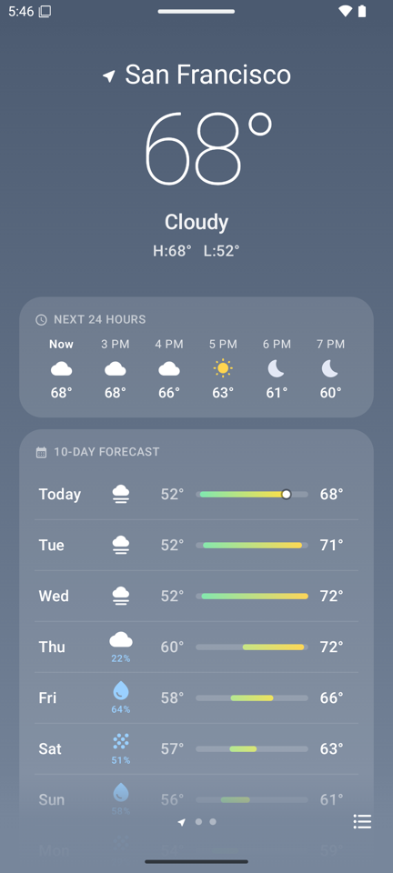
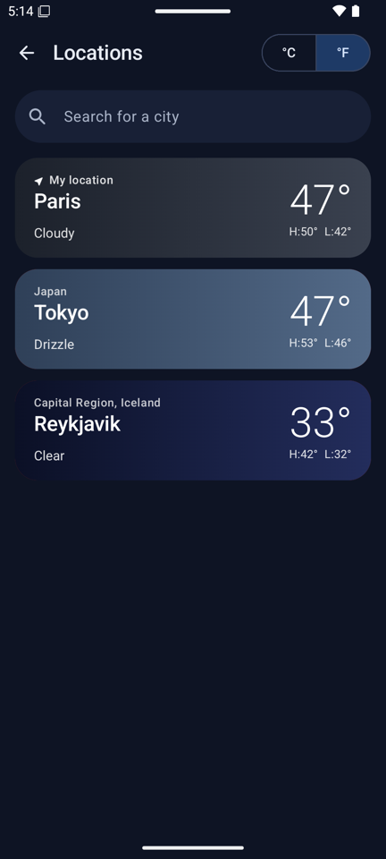

# Breeze

A clean, modern Android weather app built with Kotlin and Jetpack Compose.

<p>
  
  
  
  
</p>

## Features

- **Precise current location.** Asks for fine location and requests a fresh high-accuracy
  fix (it doesn't rely on a stale cached one). If you grant only *approximate* access, a
  small "Use precise" pill lets you upgrade later. If you've permanently denied access, the
  same button opens the app's system settings.
- **Saved locations.** Search any city worldwide and save it. Swipe between places on the
  home screen, or open the list to jump to one. Swipe a saved place left to remove it
  (with undo).
- **Uncluttered UI.** One big temperature, a compact 24-hour strip (six hours visible at a
  time), a 10-day forecast with temperature-range bars, and a few focused cards. The background
  gradient follows the current conditions and day/night.
  - **Feels like:** shows the difference from the actual temperature, colour-coded from blue
    (feels colder) to red (feels warmer).
  - **Wind:** animated streaks whose number, length and speed scale with the wind and point the
    way it blows. Also a compass and the Beaufort scale (force 0–12) with gusts.
  - **Sunrise & sunset:** the sun's path across the day. The curve is solid for time already
    passed and dotted for what's ahead, with the sun at its current position.
- **Day detail.** Tap any day in the 10-day forecast, or the 24-hour strip, for a full-day
  view, then switch days with the picker at the top. A 24-hour chart can show **temperature,
  feels like, rain chance, precipitation, humidity, wind (with gusts), UV index or cloud cover**.
  Tap or drag across it to read any hour. A dashed line shows the **10-year historical average**
  for that date and hour (from the ERA5 archive), and a plain-language daily summary compares
  the forecast with it.
- **°C / °F toggle.** The default follows your locale.
- **Fast start and offline-friendly.** The last forecast for each place is cached on disk and
  shown instantly, then refreshed in the background. Pull down to refresh.
- **No API key needed.** Forecasts, geocoding and historical data come from [Open-Meteo](https://open-meteo.com/).
- **No Google Play Services dependency.** Location uses the platform `LocationManager`
  (with the fused provider on Android 12+).

## Requirements

| Tool | Version |
| --- | --- |
| JDK | 17 or newer |
| Android SDK | Platform 37 (compile), build-tools 36+ |
| Gradle | Provided by the wrapper (9.8.2), so no separate install is needed |
| Device / emulator | Android 8.0 (API 26) or newer |

Android Studio (latest stable) works out of the box: open the project folder and press **Run**.

## Building the APK from the command line

1. **Point Gradle at your Android SDK.** Do one of the following:

   ```bash
   export ANDROID_HOME="$HOME/Android/Sdk"
   ```

   or create a `local.properties` file in the project root (it's git-ignored):

   ```properties
   sdk.dir=/home/<you>/Android/Sdk
   ```

2. **Install the SDK platform** if you don't have it yet:

   ```bash
   "$ANDROID_HOME/cmdline-tools/latest/bin/sdkmanager" "platforms;android-37.0" "build-tools;36.0.0"
   ```

3. **Build a debug APK**, which is signed with the debug key and installable right away:

   ```bash
   ./gradlew assembleDebug
   ```

   Output: `app/build/outputs/apk/debug/app-debug.apk`

4. **Or build a release APK**, minified with R8:

   ```bash
   ./gradlew assembleRelease
   ```

   Output: `app/build/outputs/apk/release/app-release.apk`

   > The release build is currently signed with the **debug key** so it can be sideloaded
   > directly. Before publishing to the Play Store, add your own `signingConfigs` block in
   > `app/build.gradle.kts` and point `release` at it.

5. **Run the unit tests:**

   ```bash
   ./gradlew testDebugUnitTest
   ```

## Installing on a device or emulator

```bash
adb install -r app/build/outputs/apk/debug/app-debug.apk
adb shell am start -n com.breeze.weather/.MainActivity
```

Or build and install in one step:

```bash
./gradlew installDebug
```

### Testing location on an emulator

```bash
# Create and start an emulator (any API 26+ image works)
avdmanager create avd -n weather_phone -k "system-images;android-36;google_apis;x86_64" -d pixel_7
emulator -avd weather_phone &

# Simulate a GPS fix (longitude first, then latitude)
adb emu geo fix -122.4194 37.7749   # San Francisco
```

The emulator only delivers a fix while an app is actively listening. If the location doesn't
change, pull to refresh on the "My location" page and send the `geo fix` again.

## Project structure

```
app/src/main/java/com/breeze/weather/
├── MainActivity.kt          # Edge-to-edge host activity
├── data/
│   ├── Models.kt            # Domain models + Open-Meteo DTOs
│   ├── Condition.kt         # WMO weather code → condition/description
│   ├── WeatherRepository.kt # Forecast, geocoding and 10-year history client with disk cache
│   ├── LocationProvider.kt  # Precise current location + reverse geocoding
│   └── PlacesStore.kt       # Saved places and unit preference (SharedPreferences)
└── ui/
    ├── BreezeApp.kt         # Navigation + permission handling
    ├── WeatherViewModel.kt  # App state, refresh policy, search
    ├── HomeScreen.kt        # Pager of places with forecast cards
    ├── DayDetailScreen.kt   # Day picker, metric selector, summary and stats for one day
    ├── MetricChart.kt       # Interactive 24h chart with historical-average overlay
    ├── WindCard.kt          # Animated wind streaks, compass, Beaufort scale
    ├── SunCard.kt           # Sun-path curve for sunrise/sunset
    ├── Components.kt        # Shared card and colour helpers
    ├── LocationsScreen.kt   # Search, saved places, unit toggle
    ├── WeatherIcons.kt      # Full-colour weather icons for every WMO code
    ├── WeatherVisuals.kt    # Gradients and formatting helpers
    └── theme/Theme.kt
```

### Icon gallery (debug builds only)

Debug builds include a screen that shows every weather icon, by day and by night, at the sizes the
app uses. It's handy when changing the icons:

```bash
adb shell am start -n com.breeze.weather/.IconGalleryActivity               # day
adb shell am start -n com.breeze.weather/.IconGalleryActivity --ez day false  # night
```

## Tech stack

Kotlin 2.4 · Jetpack Compose (Material 3) · AndroidX Lifecycle/ViewModel · kotlinx.serialization ·
Coroutines/Flow · Android Gradle Plugin 9.5.

## Credits

Weather data by [Open-Meteo.com](https://open-meteo.com/) (CC BY 4.0).
